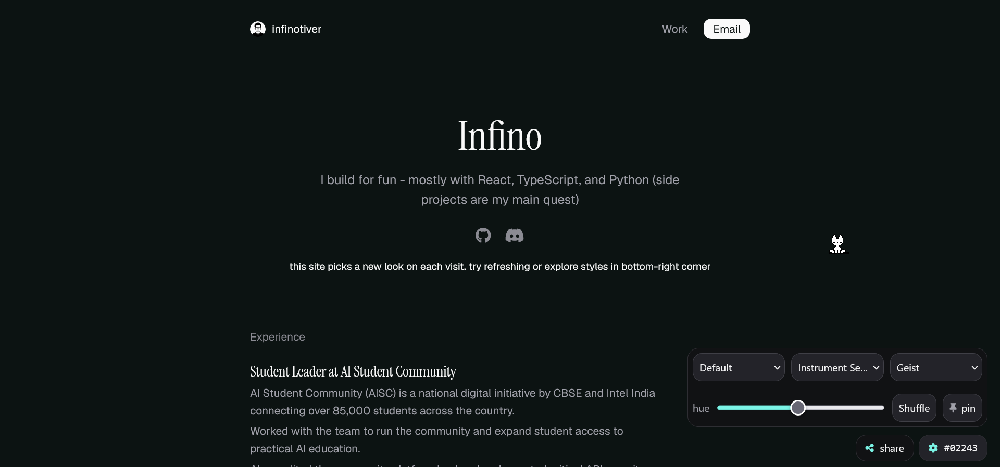
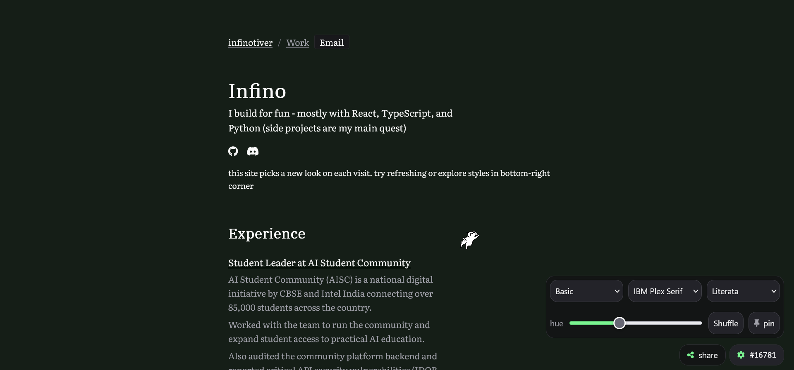
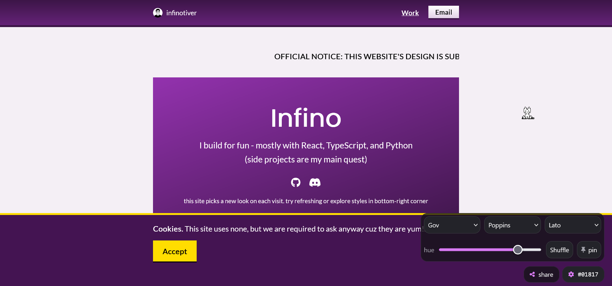
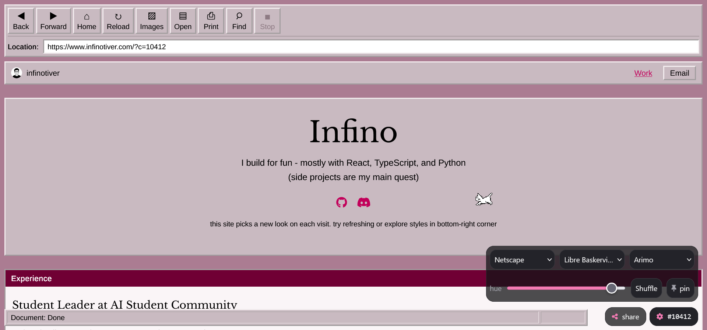
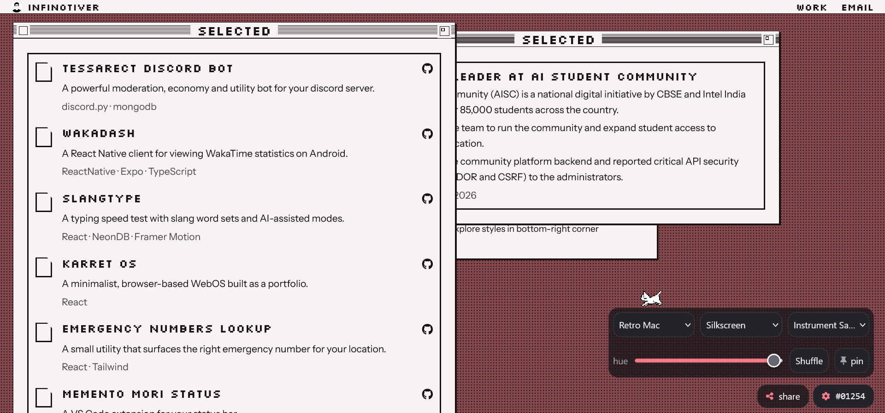
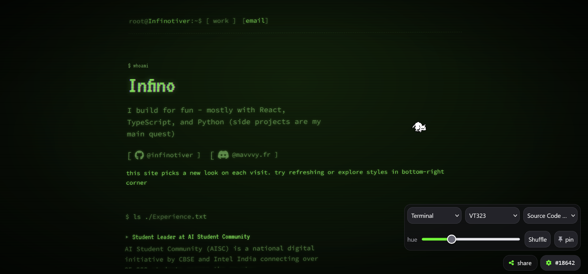
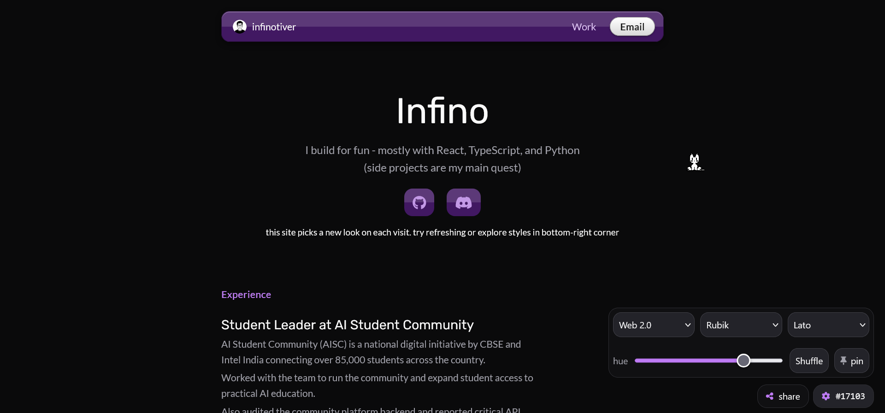

# Infinotiver
aka Infino

hi i'm a frontend developer and a self-taught programmer. i like to make websites and web apps, along with some backend stuff. i code for fun and for learning new things. currently loving linux and cybersecurity.

| Basic | Government | Netscape |
|:---:|:---:|:---:|
|  |  |  |

| Retro Mac | Terminal | Web 2.0 |
|:---:|:---:|:---:|
|  |  |  |

## how does this website work?

### what is the "code"?
the code is one number from 0 to 22679 and it decides the whole look of the site. same code = same site, always.

where does 22680 come from? i can choose 1 of 7 variants, 1 of 3 heading fonts, 1 of 3 body fonts and 1 of 360 hues:

`7 × 3 × 3 × 360 = 22680`

so every look has its own code, no two codes give the same look.

the only truly random step is `Math.floor(Math.random() * 22680)`, which picks the code. and even that only happens when nothing else sets it. the order is: a `?c=` share link (for that visit only), then a pinned code, then a random roll. an out-of-range code wraps around (`mod 22680`) and a non-numeric `?c=` falls back to 0.

### what happens after the code is picked?

**1. scramble it**

`(code * 8191) % 22680`

without this, codes 1 and 2 would look almost the same (same variant, hue 1° apart). `%` means "what's left over", like a clock: `15 % 12 = 3`.

this only works if 8191 and 22680 share no factors. 22680 = 2³ × 3⁴ × 5 × 7 and 8191 is prime, so they don't. that guarantees every code lands on a different number, no repeats.

tiny example with 10 instead of 22680 and 3 instead of 8191: codes 0 to 9 become `0, 3, 6, 9, 2, 5, 8, 1, 4, 7`. every number shows up exactly once.

**2. unpack it (like a bike lock with 4 wheels of different sizes: 360, 3, 3, 7)**

`%` reads the wheel and `Math.floor(n / size)` moves to the next one. example with code 777:

- scramble: `777 × 8191 = 6,364,407`, and `6,364,407 % 22680 = 14007`
- hue: `14007 % 360 = 327` (360 × 38 = 13680, left over 327). then `floor(14007 / 360) = 38`
- body font: `38 % 3 = 2` → 3rd body font. then `floor(38 / 3) = 12`
- heading font: `12 % 3 = 0` → 1st heading font. then `floor(12 / 3) = 4`
- variant: slot 4 = terminal (default, gov, netscape, basic, terminal, web2, retromac)

### what happens next?

so `hue` is just an angle on a color wheel, like 0° is red, 60° is yellow, 120° is green and so on. 360° is the same as 0° (full circle), which is why the range is 0 to 359.

is some hue more common than others? no. the scramble gives every code a different number, so every hue appears exactly `22680 / 360 = 63` times across all codes.

the variant gets set as `data-v="..."` on `<html>`, the fonts and hue go into `--fh`, `--fb` and `--h`, and only the 2 chosen fonts get downloaded from google fonts. the terminal, netscape, retromac and gov variants also have their own script, which is loaded only while that variant is active.

### share, pin and shuffle
- share: copies (or shares) a link with `?c=<code>`, so anyone opening it sees the same look.
- pin: saves the current code in `localStorage` so the look comes back on return visits. a `?c=` link still wins for that visit.
- shuffle: rolls a new random code.
- changing the variant, a font or the hue in the dock re-encodes the settings back into a code (the reverse of the unpack, using the inverse multiplier 3151, since `8191 × 3151 % 22680 = 1`).

### inspiration:
ngl but i had this idea in my dream after i dozed off watching Marvel's WandaVision (from 2021). i was thinking about how the show had different "eras" and how each era had its own look, and i thought it would be fun to make a website that does the same thing. so i did try to make something.

## contact:
- main site: https://infinotiver.com
- mirror: https://infinotiver.is-a.dev
- email: infinotiver@proton.me
